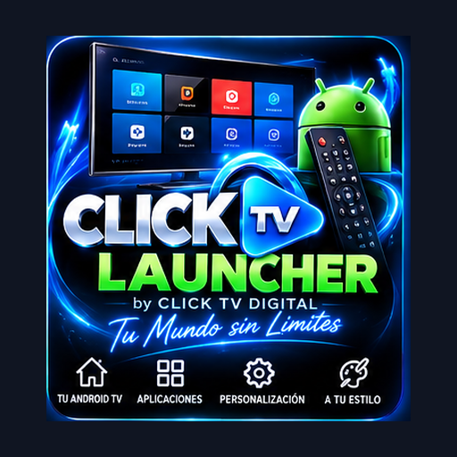
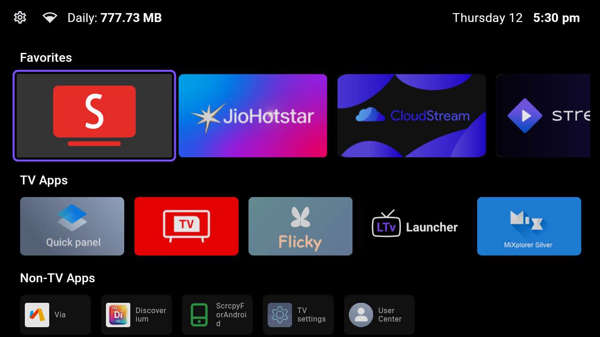
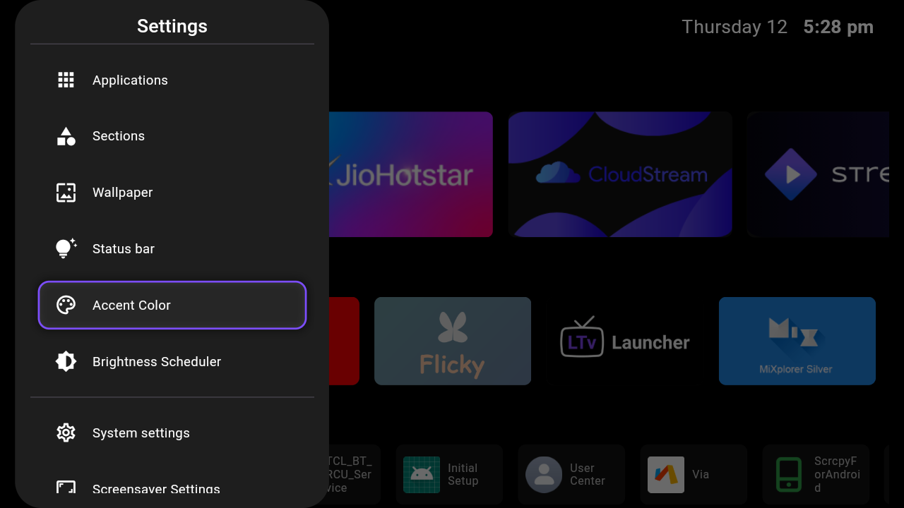
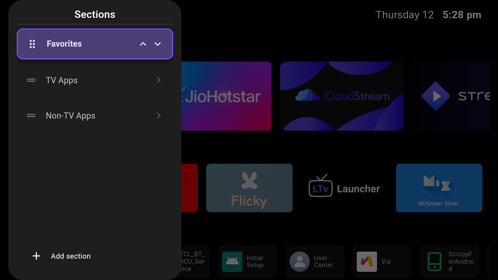
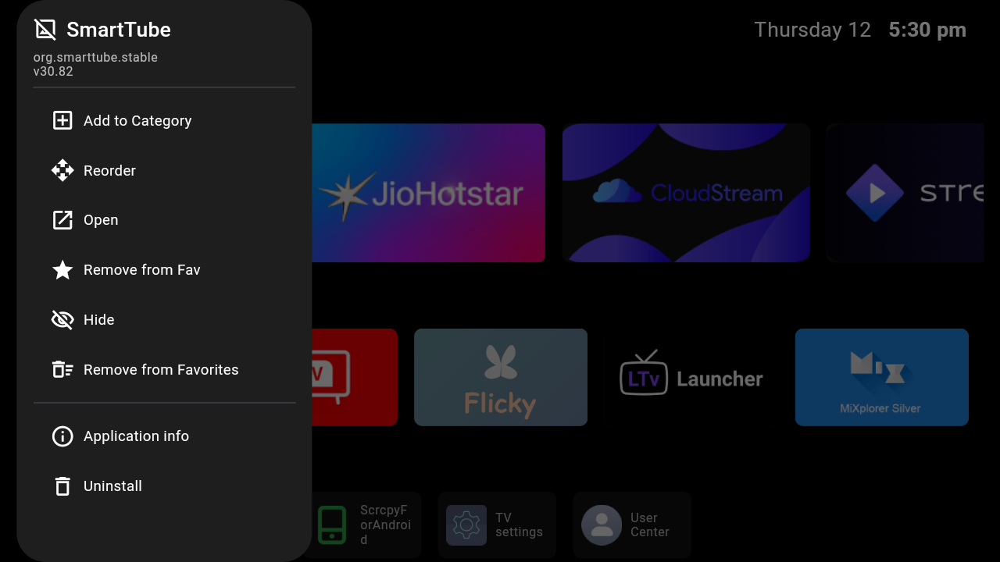

# CLICK TV LAUNCHER

<p align="center">
  
</p>

<p align="center">
  <strong>CLICK TV LAUNCHER by CLICK TV DIGITAL</strong><br>
  Un launcher libre, privado y sin anuncios para Android TV y TV Box.
</p>

<p align="center">
  
</p>

> Estado del proyecto: desarrollo activo en la rama de pruebas. El estado de CI debe comprobarse en cada commit; no se presenta como verde mientras existan trabajos o pruebas pendientes.

CLICK TV LAUNCHER está basado en [FLauncher](https://gitlab.com/flauncher/flauncher), creado originalmente por [etienn01](https://gitlab.com/flauncher/flauncher). Conserva la licencia GPLv3, los avisos de copyright y las atribuciones de sus autores.

## Características principales

- Interfaz en español por defecto, con localizaciones adicionales.
- Navegación con cruceta, OK/Enter, Atrás y controles equivalentes del mando.
- Categorías de aplicaciones, favoritos, ocultación y reordenamiento.
- Pantallas de Ajustes, Accesibilidad, Acerca de y Donativos adaptadas a TV.
- QR ampliado para los métodos que disponen de un payload real; los métodos pendientes no muestran QR ficticios.
- Splash con identidad CLICK TV, foco visible y diseño adaptable a 720p y 1080p.
- Sin anuncios, sin bloqueo de funciones y sin procesos de pago obligatorios.

Las funciones de clima, integración con Alerta EC, tráfico de red y orden inteligente de aplicaciones permanecen en revisión o desarrollo; no se anuncian aquí como terminadas.

## Compatibilidad

- Android 5.0 o posterior (API 21+).
- Android TV, Google TV y TV Box; no se requiere pantalla táctil.
- ARM de 32 bits (`armeabi-v7a`) y ARM de 64 bits (`arm64-v8a`).
- Se recomienda verificar el certificado de firma antes de actualizar una instalación existente.

La documentación no cambia el launcher del dispositivo ni elimina aplicaciones. Algunos equipos requieren elegir manualmente el launcher predeterminado desde sus ajustes del sistema.

## Vista del proyecto

Las siguientes imágenes son recursos auténticos del proyecto y no sustituyen una comprobación visual en cada televisor:

| Inicio | Aplicaciones |
| --- | --- |
|  |  |

| Ajustes | Personalización |
| --- | --- |
|  |  |

Las vistas de Acerca de, Accesibilidad y Donativos continúan evolucionando. Las capturas privadas, credenciales y QR de cuentas no se publican como miniaturas.

## Uso con el control remoto

- Usa las flechas para mover el foco y OK/Enter para activar una opción.
- Atrás cierra primero el diálogo o vista interna activa y vuelve un nivel.
- En listas y paneles desplazables, el elemento enfocado se mantiene visible.
- Si un enlace externo no tiene una aplicación compatible, el launcher conserva su navegación y muestra el error de forma controlada.

## Ajustes y Accesibilidad

La pantalla de Ajustes incluye opciones de interfaz, categorías, accesibilidad y personalización. Las instrucciones de Accesibilidad están localizadas al español y mantienen los nombres técnicos Google TV, Home Button Fix y ADB cuando son necesarios. El launcher no activa permisos de Accesibilidad por sí solo.

## Acerca de y enlaces oficiales

Los enlaces oficiales actualmente definidos para CLICK TV DIGITAL son:

- [Tienda online](https://click-tv-streaming.vercel.app)
- [TV en vivo](https://t.me/clicktvgo)
- [Streaming](https://t.me/click_tv_streaming)
- [Contacto directo por Telegram](https://t.me/clicktvdigital)

No se publica un enlace de WhatsApp hasta contar con una URL oficial válida de WhatsApp Business.

## Donativos y apoyo voluntario

CLICK TV LAUNCHER es gratuito y de código abierto. Si te resulta útil, puedes apoyar su desarrollo con un aporte voluntario. Cada ayuda permite seguir mejorando la experiencia en Android TV.

Sugerencias culturales ecuatorianas para orientar el aporte:

- ☕ Invítame un cafecito — **$1 USD**
- 🫔 Invítame un tamalito lojano con café — **$3 USD**
- 🍲 Invítame un encebollado — **$5 USD**

Patrocinios mensuales sugeridos:

- 💙 Amigo de CLICK TV — **$2 USD/mes**
- 💚 Protector de CLICK TV — **$5 USD/mes**
- 💜 Aliado de CLICK TV — **$10 USD/mes**

Son montos orientativos: no activan cobros automáticos ni beneficios de suscripción. En una transferencia o QR, la persona elige el importe al pagar. GitHub Sponsors, Patreon y Binance se muestran como pendientes dentro de la aplicación hasta confirmar sus destinos oficiales; no se presentan como pagos activos desde este repositorio.

## Instalación y desarrollo

No se enlaza una APK inexistente desde esta documentación. Para compilar una variante de desarrollo se requiere Flutter 3.24.5, Java 21, Android SDK API 35 y SQLite de desarrollo:

```bash
flutter pub get
flutter gen-l10n
flutter test
flutter build apk --debug --target-platform=android-arm,android-arm64
```

Las compilaciones firmadas y las actualizaciones de una instalación existente deben validar `applicationId`, `versionCode`, ABI y certificado con herramientas Android antes de instalarse.

## Documentación y continuidad

El documento maestro de continuidad está en [`docs/CONTINUAR_AQUI.md`](docs/CONTINUAR_AQUI.md). Allí se separan las pruebas de CI, las revisiones estáticas y las comprobaciones físicas en TV.

## Licencia y créditos

Este proyecto se distribuye bajo [GNU GPLv3](LICENSE). Se conservan los créditos, avisos y licencias de FLauncher/LeanBitLab y de las dependencias utilizadas. CLICK TV DIGITAL mantiene su identidad y sus modificaciones, sin atribuirse la autoría exclusiva del código original de terceros.

## Instalación

1. Descarga el APK de la última versión de prueba desde la pestaña **Actions** del repositorio (artefacto `CLICK-TV-LAUNCHER-PRUEBA-FIRMADA`).
2. Instálalo en el televisor o en el TV box. Sirve el mismo archivo para ambos (armeabi-v7a y arm64-v8a, Android 5 en adelante).
3. Abre **Configuración → Asistente de CLICK TV** y sigue los pasos:
   - Elige CLICK TV como inicio del TV.
   - Decide si quieres que el botón Inicio del control abra CLICK TV (corrección del botón Inicio). Tú eliges si queda activada o desactivada.
   - Si quieres quitar apps de fábrica que sólo aportan telemetría, mira la lista en **Apps de fábrica** y copia los comandos. Se desactivan, no se desinstalan.
   - Antes de cambiar algo grande, guarda una copia de seguridad.

## Novedades de la versión 2026.11.12 (8114)

- Asistente de CLICK TV en Configuración, con el estado que la app puede leer.
- Lista de apps de fábrica con comandos copiables para desactivarlas o restaurarlas.
- Fondos de Ecuador en 1920×1080: la app pesa 4.4 MB en fondos en lugar de 13.5 MB, sin diferencia visible en el televisor.
- Escala de intensidad de lluvia (Torrencial, Moderada, Ligera) a la izquierda del gráfico.
- Navegación con el control remoto pensada para Android TV.
