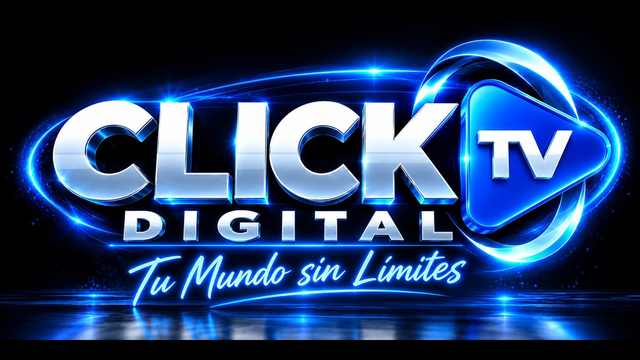

# CLICK TV LAUNCHER

CLICK TV LAUNCHER by CLICK TV DIGITAL es un lanzador libre, privado y sin anuncios para Android TV y Google TV. Está basado en [FLauncher](https://gitlab.com/flauncher/flauncher), originalmente creado por [etienn01](https://gitlab.com/flauncher/flauncher), y conserva sus licencias y atribuciones.



## Funciones

- Interfaz en español por defecto, con más idiomas disponibles.
- Navegación completa con el control remoto: cruceta, OK/Enter, Atrás y botones de juego equivalentes.
- Categorías de aplicaciones en filas o cuadrícula, favoritos, ocultación y reordenamiento.
- Canales Continue Watching, widgets de fecha, hora, red, clima y entradas TV.
- Temas, fondos, salvapantallas y perfiles de accesibilidad para Android TV/Google TV.
- Sección de apoyo con los diez métodos existentes. Los métodos pendientes se muestran como pendientes y no se activan ni se inventan enlaces.

## Compatibilidad

- Android 5.0 (API 21) o posterior.
- Android TV y Google TV; la pantalla táctil no es obligatoria.
- ARM de 32 bits (`armeabi-v7a`) y ARM de 64 bits (`arm64-v8a`).
- El APK universal incluye ambas arquitecturas; los APK divididos reducen el tamaño de descarga.

La compatibilidad indicada debe confirmarse con pruebas en el modelo concreto del televisor. Este repositorio no instala APK, cambia el launcher del equipo ni elimina datos automáticamente.

## Compilación local

Requisitos: Flutter 3.24.5, Java 21, Android SDK con API 35 y SQLite de desarrollo.

```bash
flutter pub get
flutter gen-l10n
flutter test
flutter build apk --release --target-platform=android-arm,android-arm64
```

El `applicationId` de producción es `com.clicktv.launcher` y el `versionCode` actual es 8113. Las compilaciones release deben usar el certificado oficial configurado mediante secretos; no se debe actualizar una instalación existente sin verificar primero el certificado con `apksigner`.

## GitHub Actions

- `CLICK TV LAUNCHER - Validar APK firmada`: compilación manual, validación de package, `versionCode`, ABI y certificado, y entrega como artefacto privado de prueba.
- `Release APK`: compila APK universal y divididos al crear una etiqueta o ejecutarlo manualmente. Exige `KEYSTORE_BASE64`, `KEYSTORE_PASSWORD`, `KEY_ALIAS` y `KEY_PASSWORD`; valida la firma antes de preparar los artefactos.

No se publican releases desde esta rama.

## Donaciones y atribuciones

La interfaz incluye Banco Pichincha, Banco Guayaquil, Produbanco, Banco del Pacífico, Deuna!, PayPhone, PayPal, Binance, GitHub Sponsors y Patreon. Solo se muestran datos o enlaces ya existentes en el proyecto; Binance, GitHub Sponsors y Patreon permanecen pendientes hasta confirmar sus destinos oficiales.

Se conserva la licencia [GNU GPL v3](LICENSE), los avisos de copyright y las atribuciones de FLauncher y sus colaboradores. No se deben eliminar al continuar el trabajo.

## Estado del trabajo

Consulta [`docs/CONTINUAR_AQUI.md`](docs/CONTINUAR_AQUI.md) para el estado de auditoría, las verificaciones ejecutadas y los pasos pendientes.
